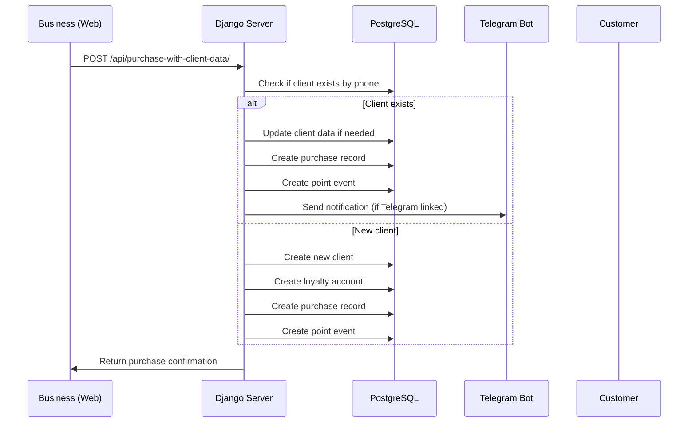
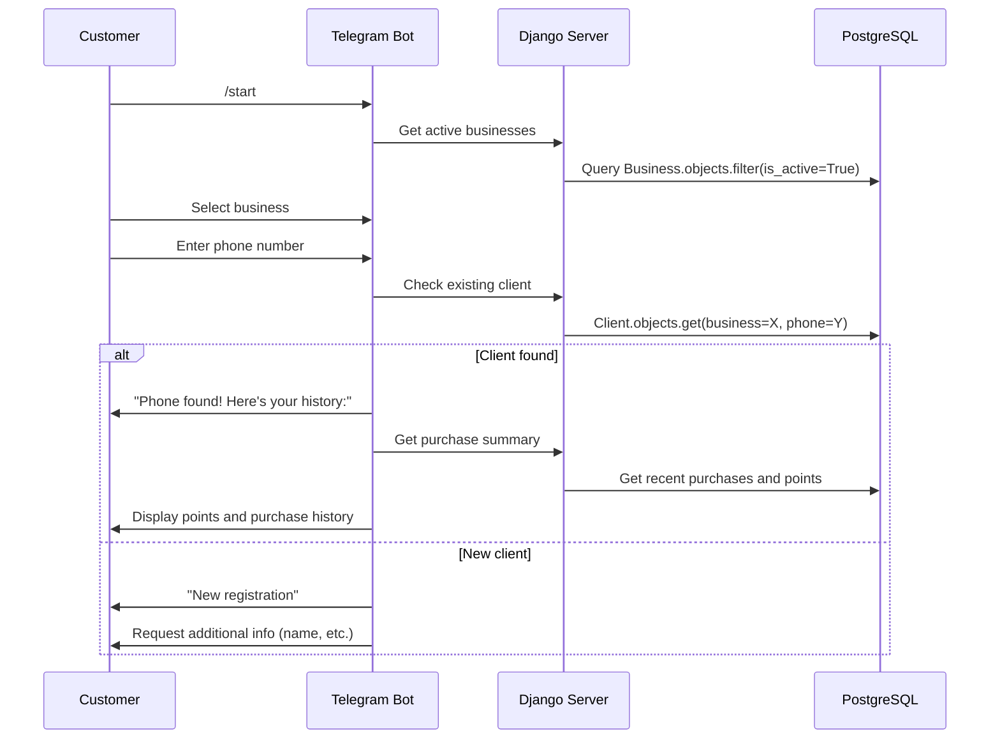

# 📐 System Design Document (DDS) – FideloBot

---

## 1. Purpose

This document describes the technical architecture of the FideloBot project, its main components, how they communicate with each other, and how the code is structured to facilitate its evolution as a complete loyalty system.

---

## 2. General Architecture

FideloBot is based on a modular architecture that includes:

- A **Django + DRF backend** to expose business logic through REST API
- A **modern web template** for businesses to register purchases
- A **Telegram bot** that interacts with end customers
- An **intelligent customer detection system** that links web and Telegram seamlessly
- A **PostgreSQL database** for reliable data storage
- A **notification system** for automatic customer engagement

---

## 3. System Components

### 3.1 Django Backend API

**Responsibilities:**
- CRUD operations for Businesses, Clients, and Purchases
- Points calculation logic through services
- REST API endpoints for external clients
- Web template rendering for businesses
- Business authentication and session management

**Key Apps:**
- `core/` - Main application containing all models and business logic
- `telegram_bot/` - Bot implementation and advanced features

**Core Models:**
```python
# Business Model
- business_id (UUID)
- name, email, timezone
- points_per_currency (Decimal)
- birthday_bonus_points (Integer)

# Client Model
- client_id (UUID)
- business (ForeignKey)
- name, email, phone, birthday
- unique_together: (business, email), (business, phone)

# Purchase Model
- purchase_id (UUID)
- business, client (ForeignKeys)
- amount, currency
- purchased_at

# PointEvent Model
- event_id (UUID)
- business, client (ForeignKeys)
- source (purchase/birthday/adjustment)
- points (Integer)
- related_purchase, note
```

---

### 3.2 Web Template (Business Interface)

**Responsibilities:**
- Business authentication and selection
- Purchase registration with customer data
- Automatic client detection (new vs existing)
- Professional UI with glassmorphism design
- Modal confirmations with purchase details

**Key Features:**
- **Smart Client Detection**: Automatically detects existing clients by phone
- **Multi-Business Support**: Dropdown selection with session management
- **Modern UI**: Professional design with Font Awesome icons
- **Real-time Feedback**: Instant validation and confirmation modals

**Technology Stack:**
- HTML5 + CSS3 (Glassmorphism design)
- Vanilla JavaScript (ES6+)
- Font Awesome icons
- Responsive design principles

---

### 3.3 Telegram Bot

**Responsibilities:**
- Customer registration and authentication
- Points balance and history queries
- Interactive navigation with inline keyboards
- Automatic detection of existing customers
- Real-time purchase notifications

**Bot Commands:**
```
/start          - Start/restart the bot
/points         - View points balance
/history        - View complete transaction history
/profile        - View profile information
/help           - List available commands
/link_telegram  - Link existing account by email/phone
```

**Advanced Features:**
- **Phone-based Detection**: Automatically links web-registered customers
- **Interactive Navigation**: Buttons for seamless user experience
- **Multi-Business Support**: Users can register in multiple businesses
- **Purchase History**: Complete event tracking with icons and dates

---

### 3.4 Intelligent Customer Management System

**Core Innovation:**
The system seamlessly connects web and Telegram interactions through intelligent customer detection.

**Flow Example:**
1. **Business registers purchase** via web with customer phone `+529511577551`
2. **Customer opens Telegram bot** and selects same business
3. **System automatically detects** existing purchase history by phone
4. **Customer immediately sees** their points and purchase history
5. **Future purchases** are automatically linked to their Telegram account

**Detection Logic:**
```python
# In bot registration
existing_client = Client.objects.get(business=business, phone=phone)
if existing_client:
    # Link Telegram account
    existing_client.email = f"telegram_{telegram_id}@fidelo.local"
    # Show purchase history immediately
    display_purchase_summary(existing_client)
```

---

### 3.5 Notification System

**Current Implementation:**
- **Telegram Notifications**: Automatic for linked customers
- **SMS Notifications**: Disabled (Twilio integration ready but commented out)

**Notification Types:**
- Purchase confirmations with points earned
- Birthday bonuses
- Special promotions (future)

---

## 4. Data Flow Architecture

### 4.1 Purchase Registration Flow



### 4.2 Bot Registration Flow



---

## 5. Security Considerations

### 5.1 Data Protection
- **Phone Number Privacy**: Used only for customer linking
- **Business Isolation**: Strict filtering by business_id
- **Session Security**: Business authentication with secure sessions

### 5.2 Input Validation
- **Phone Format**: International format validation (+1234567890)
- **Amount Validation**: Decimal precision for currency
- **Business Access**: Session-based business authentication

### 5.3 API Security
- **CSRF Protection**: Django's built-in CSRF middleware
- **SQL Injection**: ORM-based queries prevent injection
- **Rate Limiting**: Ready for implementation with Django-ratelimit

---

## 6. Database Design

### 6.1 Entity Relationships

```
Business (1) ----< (N) Client (1) ----< (N) Purchase
    |                    |                    |
    |                    |                    |
    |             LoyaltyAccount (1:1)   PointEvent (N)
    |                    |                    |
    ----------------------                    |
           (1:N)                             |
                                             |
           PointEvent >----------------------
```

### 6.2 Key Constraints
- **unique_together**: (business, email) and (business, phone) in Client model
- **Cascading Deletes**: Client deletion removes associated LoyaltyAccount and PointEvents
- **UUID Primary Keys**: All models use UUID for better security and distribution

---

## 7. Performance Considerations

### 7.1 Database Optimization
- **Indexes**: Created on frequently queried fields (business_id, phone, email)
- **Query Optimization**: Use of select_related and prefetch_related
- **Connection Pooling**: PostgreSQL connection pooling for concurrent users

### 7.2 Caching Strategy (Future)
- **Redis Integration**: For session storage and frequent queries
- **Template Caching**: Cache business dropdown data
- **API Response Caching**: Cache business information and exchange rates

---

## 8. Deployment Architecture

### 8.1 Development Environment
```
Django Server (127.0.0.1:8080)
    ├── Web Template (/purchase-form/)
    ├── API Endpoints (/api/*)
    └── Admin Panel (/admin/)

Telegram Bot (Separate Process)
    ├── Polling Mode
    └── Direct API Calls to Django

PostgreSQL Database
    ├── Local Instance
    └── Development Data
```

### 8.2 Production Environment (Recommended)
```
Load Balancer
    ├── Django Application Server (Gunicorn)
    ├── Static Files (Nginx)
    └── Media Files (Nginx)

Telegram Bot
    ├── Webhook Mode
    └── Queue System (Celery + Redis)

Database
    ├── PostgreSQL Primary
    ├── Redis Cache
    └── Backup Strategy
```

---

## 9. Technology Stack

### 9.1 Backend
- **Framework**: Django 5.x
- **API**: Django REST Framework
- **Database**: PostgreSQL 12+
- **Python**: 3.11+

### 9.2 Frontend
- **Web Template**: HTML5, CSS3 (Glassmorphism), Vanilla JavaScript
- **Icons**: Font Awesome 6
- **Design**: Responsive, Mobile-first

### 9.3 Bot
- **Library**: python-telegram-bot 20.x
- **Architecture**: Async/await pattern
- **Features**: Inline keyboards, callback queries, file handling

### 9.4 DevOps
- **Environment**: python-decouple for configuration
- **Database Migrations**: Django built-in migration system
- **Logging**: Django logging framework

---

## 10. Future Enhancements

### 10.1 Short Term
- [ ] Admin dashboard for businesses
- [ ] Point redemption system
- [ ] Automated promotional campaigns
- [ ] WhatsApp Business API integration

### 10.2 Long Term
- [ ] Multi-language support
- [ ] Advanced analytics and reporting
- [ ] POS system integrations
- [ ] Mobile app (React Native/Flutter)
- [ ] Blockchain-based loyalty tokens

---

## 11. Code Organization

### 11.1 Django Project Structure
```
fidelo-bot-backend/
├── core/                       # Main application
│   ├── models.py              # Data models
│   ├── views.py               # Web views and API endpoints
│   ├── serializers.py         # DRF serializers
│   ├── services.py            # Business logic services
│   ├── admin.py               # Django admin configuration
│   └── migrations/            # Database migrations
├── telegram_bot/              # Telegram bot implementation
│   ├── bot.py                 # Main bot logic
│   └── advanced_bot_features.py  # Advanced features
├── templates/                 # HTML templates
│   └── purchase_form.html     # Business purchase form
├── static/                    # Static files (CSS, JS)
├── fidelo_backend/            # Django project settings
│   ├── settings.py            # Main configuration
│   ├── urls.py                # URL routing
│   └── wsgi.py                # WSGI application
└── docs/                      # Documentation
    ├── DDS.md                 # This document
    ├── SRS.md                 # Requirements specification
    └── API.md                 # API documentation
```

### 11.2 Service Layer Pattern
The application follows a clean architecture with a dedicated service layer:

```python
# core/services.py
class ClientService:
    @staticmethod
    def create_client_with_account(**client_data):
        # Business logic for client creation

class PointsService:
    @staticmethod
    def calculate_points(amount, business):
        # Points calculation logic

    @staticmethod
    def award_birthday_bonus(client):
        # Birthday bonus logic
```

---

This document reflects the current state of the FideloBot MVP and serves as a technical reference for developers working on the project.